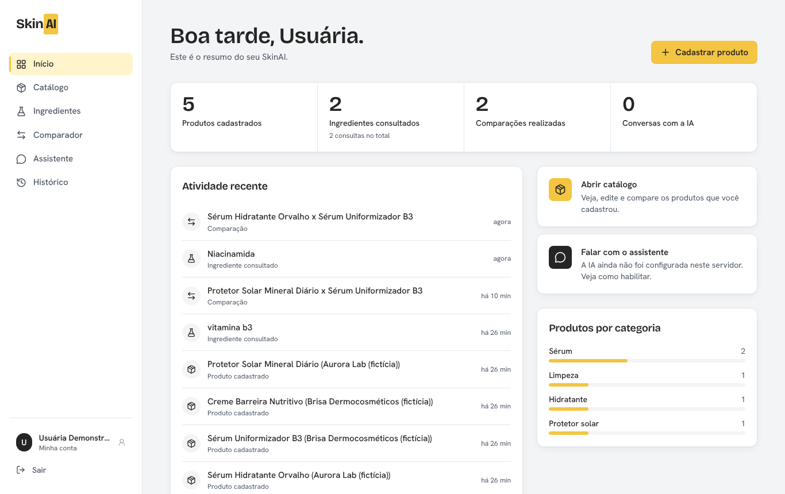
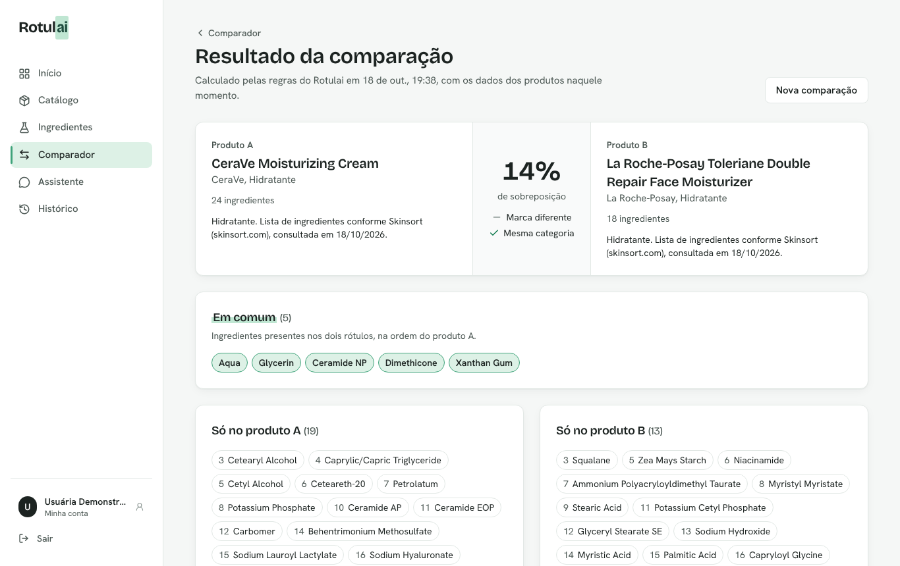
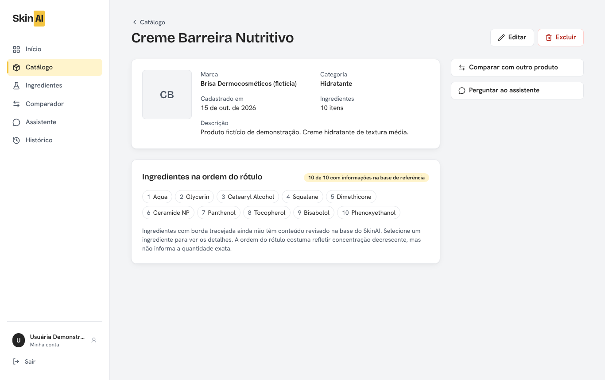
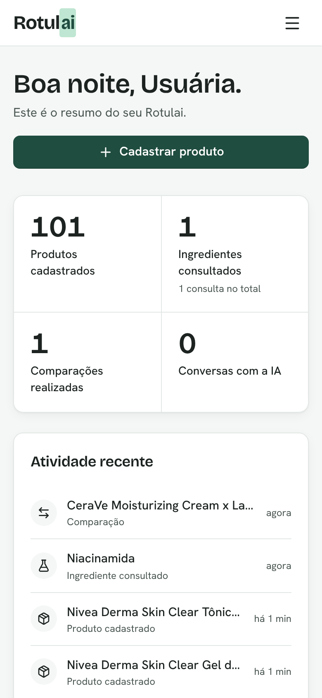

# Rotulai

Plataforma full stack para organizar cosméticos, entender ingredientes de rótulos e comparar produtos, com um assistente de inteligência artificial integrado pelo servidor.



> **Aviso:** o Rotulai fornece informações educacionais. Não diagnostica doenças, não prescreve tratamentos, não garante ausência de alergias e não substitui a orientação de um dermatologista.

## Sumário

- [Problema](#problema)
- [Funcionalidades](#funcionalidades)
- [Tecnologias](#tecnologias)
- [Arquitetura](#arquitetura)
- [Estrutura de pastas](#estrutura-de-pastas)
- [Como executar](#como-executar)
- [Variáveis de ambiente](#variáveis-de-ambiente)
- [Testes e qualidade](#testes-e-qualidade)
- [API](#api)
- [Build e deploy](#build-e-deploy)
- [Segurança](#segurança)
- [Limitações conhecidas](#limitações-conhecidas)
- [Próximas melhorias](#próximas-melhorias)

## Problema

Rótulos de cosméticos usam a nomenclatura INCI, em inglês ou latim, e listas longas de ingredientes. Quem quer entender o que está usando acaba alternando entre buscas na internet, conteúdos sem fonte e anotações soltas. O Rotulai centraliza esse fluxo:

- um catálogo público de produtos com a lista de ingredientes de cada um e a fonte da lista;
- favoritos para a pessoa guardar os produtos que usa ou quer conhecer;
- uma base de referência de ingredientes com conteúdo revisado e fontes para verificação;
- comparação objetiva entre dois produtos, calculada por regras determinísticas;
- um assistente de IA para explicar termos, sempre identificado como conteúdo gerado por IA.

## Funcionalidades

| Área                       | O que faz                                                                                                                                                                                                                                                                  |
| -------------------------- | -------------------------------------------------------------------------------------------------------------------------------------------------------------------------------------------------------------------------------------------------------------------------- |
| **Autenticação**           | Cadastro, login, sessão persistente com rotação de refresh token, logout e exclusão de conta com todos os dados.                                                                                                                                                           |
| **Página inicial pública** | A rota `/` apresenta o RotulAI e uma amostra do catálogo sem exigir login; o dashboard autenticado está em `/dashboard`.                                                                                                                                                   |
| **Dashboard**              | Em `/dashboard`, apresenta saudação, indicadores reais (favoritos, ingredientes consultados, comparações, conversas), atividade recente e acessos rápidos.                                                                                                                 |
| **Catálogo público**       | Páginas sem login em `/catalogo` e `/catalogo/ingredientes`, com busca tolerante a erros de digitação e por sinônimos ("filtro solar" encontra protetores), sugestões, filtros, fontes e metadados por página.                                                             |
| **Favoritos**              | Pessoas logadas salvam produtos do catálogo público. Os favoritos alimentam o comparador e o contexto do assistente.                                                                                                                                                       |
| **Administração**          | Perfil `ADMIN` mantém produtos do catálogo, ingredientes curados, sinônimos de busca e regras de indicação versionadas. Ingredientes são vinculados sem duplicação (inclusive por sinônimo: "Glicerina" = "Glycerin").                                                     |
| **Ingredientes**           | Consulta por nome INCI ou nome comum, base de referência com 30 ingredientes revisados, sinônimos, funções, uso, cuidados e fontes. Conteúdo da base e explicação da IA aparecem em blocos separados. Quando não há informação confiável, a interface informa a limitação. |
| **Comparador**             | Compara dois favoritos: ingredientes em comum, exclusivos de cada produto, marca, categoria e percentual de sobreposição (índice de Jaccard). A IA pode explicar as diferenças, sem declarar qual produto é melhor.                                                        |
| **Assistente Rotulai**     | Chat com histórico, sugestões iniciais, contexto opcional de até 2 favoritos, limite de caracteres, indicador de digitação e mensagens claras de indisponibilidade.                                                                                                        |
| **Histórico**              | Consultas de ingredientes, comparações e conversas persistidas no PostgreSQL, com exclusão individual, limpeza por tipo e política de retenção visível ao usuário.                                                                                                         |

### Telas

| Comparação                                     | Detalhe do produto                       | Celular                                 |
| ---------------------------------------------- | ---------------------------------------- | --------------------------------------- |
|  |  |  |

## Tecnologias

**Front-end:** React 19, TypeScript, Vite, Tailwind CSS 4, React Router, TanStack Query, React Hook Form, Zod, Lucide React.

**Back-end:** Node.js, TypeScript, Express 5, Zod, Prisma ORM 7 (adapter `pg`), PostgreSQL 16 (com `pg_trgm` e `unaccent` para a busca), Swagger UI / OpenAPI 3.1, Helmet, express-rate-limit, bcrypt, JWT, Pino.

**IA:** SDK oficial da Anthropic atrás de uma interface própria (`LlmProvider`), selecionada por variável de ambiente.

**Testes e qualidade:** Vitest, Supertest, React Testing Library, ESLint, Prettier, GitHub Actions.

## Arquitetura

```
┌──────────────────────┐      HTTPS / JSON       ┌──────────────────────────────┐
│  Front-end (React)   │ ──────────────────────▶ │  API REST (Express)          │
│  - páginas e UI      │  Authorization: Bearer  │  - validação (Zod)           │
│  - TanStack Query    │  cookie httpOnly (RT)   │  - autenticação/autorização  │
│  - token em memória  │ ◀────────────────────── │  - regras de negócio         │
└──────────────────────┘                         │  - serviço de IA ─────────┐  │
                                                 └──────────┬────────────────┼──┘
                                                            │ Prisma         │ HTTPS
                                                            ▼                ▼
                                                   ┌────────────────┐  ┌──────────────┐
                                                   │  PostgreSQL    │  │ API de LLM   │
                                                   └────────────────┘  └──────────────┘
```

- O front-end só conversa com a API. A chave de IA existe apenas no servidor.
- Regras de negócio, validações e acesso a dados ficam no back-end, organizados por módulo (`routes` → `service` → Prisma).
- A comparação de produtos é uma função pura (`compare-products.ts`), testável sem banco.
- A IA passa por `AiService`, que aplica tempo limite, cota diária, validação da resposta e conversão de erros, independentemente do provedor.

Detalhes em [docs/ARQUITETURA.md](docs/ARQUITETURA.md).

## Estrutura de pastas

```
Rotulai/
├── backend/
│   ├── prisma/              # schema, migrações versionadas e seed
│   ├── src/
│   │   ├── config/          # leitura e validação das variáveis de ambiente
│   │   ├── docs/            # especificação OpenAPI
│   │   ├── lib/             # Prisma, logger, erros, paginação, validações compartilhadas
│   │   ├── middleware/      # autenticação, validação, rate limit, erros
│   │   ├── modules/         # auth, catalog, favorites, admin, ingredients, comparisons, conversations, ai, ...
│   │   ├── app.ts           # montagem do Express (injeção do serviço de IA)
│   │   └── server.ts        # inicialização e rotina de retenção
│   ├── scripts/             # bootstrap do admin, migração de produtos legados, benchmark da busca
│   └── tests/               # unitários e integração (Supertest + PostgreSQL)
├── frontend/
│   ├── src/
│   │   ├── auth/            # contexto de sessão e guardas de rota
│   │   ├── components/      # layout e componentes reutilizáveis
│   │   ├── features/        # páginas por domínio
│   │   ├── lib/             # cliente HTTP, queries, formatação
│   │   └── types/           # contratos da API
│   └── tests/
├── docs/                    # arquitetura, API e capturas de tela
├── docker/                  # script de inicialização do PostgreSQL
├── docker-compose.yml
└── .github/workflows/ci.yml
```

## Como executar

### Requisitos

- Node.js 20.19 ou superior (recomendado 22 LTS) e npm 10+
- Docker Desktop (para o PostgreSQL) **ou** um PostgreSQL 14+ já instalado, com as extensões `pg_trgm` e `unaccent` disponíveis (vêm no pacote padrão `contrib`)
- Opcional: chave da API Anthropic para habilitar a IA

### 1. Instalar dependências

```bash
git clone https://github.com/MilenaAmaral/Rotulai.git
cd Rotulai
npm run setup        # instala tudo e gera o Prisma Client
```

### 2. Subir o PostgreSQL

```bash
npm run db:up        # docker compose up -d db
```

O contêiner cria o usuário `rotulai` (senha `rotulai`), o banco `rotulai` e o banco de testes `rotulai_test`. Com um PostgreSQL próprio, crie os dois bancos e ajuste `DATABASE_URL` e `TEST_DATABASE_URL`.

### 3. Configurar variáveis de ambiente

```bash
cp backend/.env.example backend/.env
cp frontend/.env.example frontend/.env
```

No Windows (PowerShell): `Copy-Item backend/.env.example backend/.env`.

Edite `backend/.env` e defina um `JWT_ACCESS_SECRET` aleatório:

```bash
node -e "console.log(require('crypto').randomBytes(48).toString('hex'))"
```

### 4. Migrações e dados de demonstração

```bash
npm run db:migrate                 # aplica as migrações (prisma migrate dev)
npm run db:seed                    # base de referência com 30 ingredientes revisados
npm run db:seed-public -w backend  # catálogo público com 101 produtos e os sinônimos de busca
```

Os dois seeds são idempotentes: podem ser executados de novo para atualizar o conteúdo, sem apagar contas, favoritos ou históricos.

Não existe conta de demonstração. Crie uma conta pela tela de cadastro (perfil `FREE`). Para acessar o painel de administração, promova uma conta ou crie a primeira com:

```bash
# em backend/.env: BOOTSTRAP_ADMIN_EMAIL e BOOTSTRAP_ADMIN_PASSWORD (mín. 12 caracteres)
npm run admin:bootstrap -w backend
```

Depois de executar, apague as duas variáveis do `.env`. O comando nunca troca a senha de uma conta existente.

### Catálogo de demonstração

O seed público cadastra **101 produtos de skincare** de 13 marcas encontradas no Brasil (Avène, Bioderma, CeraVe, Cetaphil, Eucerin, ISDIN, La Roche-Posay, Neutrogena, Nivea, Principia, Sallve, The Ordinary e Vichy), distribuídos entre limpeza, hidratantes, séruns, protetores solares, tônicos, tratamentos e área dos olhos.

- As listas de ingredientes foram copiadas das páginas públicas do [Skinsort](https://skinsort.com) em 18/10/2026. Cada produto guarda o link da página de origem (`referenceUrl`), exibido na tela de detalhes.
- Fórmulas mudam e podem variar por país e lote. O rótulo da embalagem é sempre a fonte definitiva.
- Os dados ficam em `backend/prisma/data/catalogo-produtos.json`, validados por teste automatizado com as mesmas regras do cadastro pela API.
- As marcas e nomes de produtos pertencem aos respectivos titulares. O Rotulai não tem afiliação com nenhuma delas, não exibe imagens de produtos e não faz recomendação de compra.

### 5. Executar

Em dois terminais:

```bash
npm run dev:backend   # API em http://localhost:3333 (docs em /api/docs)
npm run dev:frontend  # interface em http://localhost:5173
```

Em desenvolvimento, o Vite encaminha `/api` para a API, então front e back compartilham a mesma origem.

### 6. Habilitar a IA (opcional)

Em `backend/.env`:

```env
AI_PROVIDER=anthropic
ANTHROPIC_API_KEY=sua-chave
AI_MODEL=claude-haiku-5-5
```

Reinicie a API. Sem a chave, o assistente e os botões de explicação mostram como habilitar a funcionalidade, e todo o restante continua funcionando. A aplicação nunca simula respostas de IA.

## Variáveis de ambiente

### Back-end (`backend/.env`)

| Variável                              | Padrão                  | Descrição                                         |
| ------------------------------------- | ----------------------- | ------------------------------------------------- |
| `DATABASE_URL`                        | obrigatória             | Conexão PostgreSQL.                               |
| `TEST_DATABASE_URL`                   | `.../rotulai_test`      | Banco dos testes (nome deve terminar em `_test`). |
| `PORT`                                | `3333`                  | Porta da API.                                     |
| `CORS_ORIGINS`                        | `http://localhost:5173` | Origens permitidas, separadas por vírgula.        |
| `TRUST_PROXY`                         | `0`                     | Proxies confiáveis (use `1` em Render/Railway).   |
| `JWT_ACCESS_SECRET`                   | obrigatória             | Segredo do access token (mín. 32 caracteres).     |
| `ACCESS_TOKEN_TTL_MINUTES`            | `15`                    | Validade do access token.                         |
| `REFRESH_TOKEN_TTL_DAYS`              | `7`                     | Validade do refresh token.                        |
| `COOKIE_SAMESITE` / `COOKIE_SECURE`   | `lax` / automático      | Política do cookie de sessão.                     |
| `BCRYPT_ROUNDS`                       | `12`                    | Custo do hash de senha.                           |
| `AI_PROVIDER`                         | `anthropic`             | `anthropic` ou `none`.                            |
| `ANTHROPIC_API_KEY`                   | vazio                   | Chave da IA (somente servidor).                   |
| `AI_MODEL`                            | `claude-haiku-5-5`      | Modelo utilizado.                                 |
| `AI_TIMEOUT_MS`                       | `30000`                 | Tempo limite por chamada.                         |
| `AI_MAX_INPUT_CHARS`                  | `2000`                  | Tamanho máximo da mensagem.                       |
| `AI_MAX_OUTPUT_TOKENS`                | `1024`                  | Tamanho máximo da resposta.                       |
| `AI_HISTORY_MESSAGES`                 | `12`                    | Mensagens anteriores enviadas como contexto.      |
| `AI_RATE_LIMIT_PER_MINUTE`            | `10`                    | Requisições de IA por usuário por minuto.         |
| `AI_DAILY_LIMIT_PER_USER`             | `100`                   | Chamadas de IA por usuário em 24 h.               |
| `HISTORY_RETENTION_DAYS`              | `180`                   | Retenção do histórico.                            |
| `BOOTSTRAP_ADMIN_EMAIL` / `_PASSWORD` | vazio                   | Usadas apenas por `admin:bootstrap`.              |

### Front-end (`frontend/.env`)

| Variável       | Descrição                                                                                    |
| -------------- | -------------------------------------------------------------------------------------------- |
| `VITE_API_URL` | URL pública da API. Deixe vazio em desenvolvimento ou quando a API estiver no mesmo domínio. |

## Testes e qualidade

```bash
npm test                          # back-end (unitários + integração) e front-end
npm run test:unit -w backend      # só os testes do back-end que não usam banco
npm run lint
npm run typecheck
npm run format:check
```

Os testes de integração do back-end precisam de um PostgreSQL acessível em `TEST_DATABASE_URL` (o `docker compose` já cria o banco `rotulai_test`). As migrações são aplicadas automaticamente e **as tabelas são esvaziadas entre os testes**. Por isso a suíte se recusa a rodar se o nome do banco não terminar em `_test` ou se for o mesmo banco de `DATABASE_URL` do `backend/.env`.

O back-end cobre:

- validação das requisições (incluindo links somente `https://` no painel admin);
- regras determinísticas de comparação e normalização da busca;
- autenticação: hash de senha, cookie httpOnly, rotação e detecção de reuso de refresh token, proteção CSRF, logout, exclusão de conta e cadastros simultâneos com o mesmo e-mail;
- perfis de acesso (visitante, `FREE` e `ADMIN`) e isolamento de dados entre usuários;
- catálogo público, favoritos e comparação/contexto da IA restritos a produtos do catálogo;
- falhas da integração com IA (não configurada, indisponível, tempo limite, resposta inválida, cota) usando um provedor de teste;
- retenção de dados, CORS, cabeçalhos de segurança e tratamento central de erros (inclusive conflitos do banco).

O front-end testa a visualização da comparação, o painel admin de produtos (edição sem quebrar nomes como "1,2-Hexanediol"), a leitura dos campos do admin, a renderização segura do texto da IA, os metadados das páginas públicas e o parser de ingredientes.

## API

Documentação interativa (Swagger UI): `http://localhost:3333/api/docs` · especificação: `/api/docs.json`.

| Método              | Rota                                                        | Descrição                                                         |
| ------------------- | ----------------------------------------------------------- | ----------------------------------------------------------------- |
| GET                 | `/api/health`                                               | Health check (API e banco)                                        |
| POST                | `/api/auth/register` · `/login` · `/refresh` · `/logout`    | Sessão                                                            |
| GET / DELETE        | `/api/auth/me`                                              | Usuário atual / excluir conta                                     |
| GET                 | `/api/dashboard`                                            | Indicadores e atividades                                          |
| GET                 | `/api/catalog/products` · `/api/catalog/products/:slug`     | Catálogo público, busca/filtro e detalhe (sem login)              |
| GET                 | `/api/catalog/ingredients` · `/api/catalog/ingredients/:id` | Ingredientes curados públicos, busca/filtro e detalhe (sem login) |
| GET / PUT / DELETE  | `/api/favorites` · `/api/favorites/:productId`              | Listar / salvar / remover favoritos                               |
| GET                 | `/api/products` · `/api/products/:id`                       | Produtos pessoais legados (somente leitura para `FREE`)           |
| GET                 | `/api/ingredients` · `/api/ingredients/:id`                 | Base de ingredientes                                              |
| GET / POST / DELETE | `/api/ingredient-analyses`                                  | Histórico / nova consulta / limpar                                |
| POST                | `/api/ingredient-analyses/:id/explanation`                  | Explicação por IA                                                 |
| GET / POST / DELETE | `/api/comparisons`                                          | Histórico / comparar dois produtos do catálogo / limpar           |
| POST                | `/api/comparisons/:id/explanation`                          | Explicação por IA                                                 |
| GET / POST / DELETE | `/api/conversations`                                        | Conversas / iniciar / limpar                                      |
| POST                | `/api/conversations/:id/messages`                           | Enviar mensagem                                                   |
| GET                 | `/api/ai/status` · `/api/history/policy`                    | Status da IA / política de retenção                               |
| CRUD                | `/api/admin/*`                                              | Catálogo, ingredientes, sinônimos e regras (perfil `ADMIN`)       |

Detalhes, formatos e códigos de erro em [docs/API.md](docs/API.md).

## Build e deploy

```bash
npm run build        # gera backend/dist e frontend/dist
npm start -w backend # executa a API compilada
```

### Vercel (front-end e API no mesmo projeto)

O `vercel.json` da raiz usa [Vercel Services](https://vercel.com/docs/services) (beta): o front-end responde em `/` e a API em `/api`, no mesmo domínio. Assim o cookie de sessão funciona com `COOKIE_SAMESITE=lax` e `VITE_API_URL` fica vazio. Não há chamadas entre servidores, então nenhum _binding_ é necessário.

| Serviço    | Pasta      | Caminho público | Build                                          |
| ---------- | ---------- | --------------- | ---------------------------------------------- |
| `frontend` | `frontend` | `/`             | `npm run build` → `dist` (com fallback SPA)    |
| `backend`  | `backend`  | `/api`          | `npm run db:generate`; entrada `src/server.ts` |

**1. Banco de produção.** Crie um banco PostgreSQL separado do de desenvolvimento (por exemplo, um projeto novo no Neon). O Neon oferece duas URLs: a _pooled_ (host com `-pooler`), para a aplicação, e a direta, para migrações. Aplique as migrações e os dados a partir da sua máquina, informando a URL direta só na linha de comando:

```bash
cd backend
DATABASE_URL="<url-direta>" npx prisma migrate deploy
DATABASE_URL="<url-direta>" npm run db:seed
DATABASE_URL="<url-direta>" npm run db:seed-public
DATABASE_URL="<url-direta>" BOOTSTRAP_ADMIN_EMAIL="voce@exemplo.com" BOOTSTRAP_ADMIN_PASSWORD="<senha-forte>" npm run admin:bootstrap
```

No PowerShell, defina antes cada variável com `$env:DATABASE_URL="<url-direta>"` e remova ao final com `Remove-Item Env:DATABASE_URL`.

**2. Variáveis no painel da Vercel** (_Settings → Environment Variables_):

| Variável            | Valor                                                               |
| ------------------- | ------------------------------------------------------------------- |
| `DATABASE_URL`      | URL _pooled_ do banco de produção                                   |
| `JWT_ACCESS_SECRET` | segredo novo, gerado com o comando da seção de configuração         |
| `NODE_ENV`          | `production`                                                        |
| `TRUST_PROXY`       | `1`                                                                 |
| `CORS_ORIGINS`      | domínio público, ex.: `https://rotulai.vercel.app`                  |
| `AI_PROVIDER`       | `none` (ou `anthropic` com `ANTHROPIC_API_KEY` para habilitar a IA) |

**3. Importar o repositório** na Vercel mantendo o diretório raiz `./`. O painel detecta os dois serviços a partir do `vercel.json`.

Particularidades da execução como função da Vercel:

- A API roda como Vercel Function. A rotina de retenção roda quando uma instância inicia, e não a cada 24 horas garantidas; para uma execução diária fixa, use um [Cron Job](https://vercel.com/docs/cron-jobs).
- O rate limit fica em memória por instância, então os limites valem por instância e não globalmente.
- A Vercel não serve arquivos com `express.static()`, então a interface do Swagger em `/api/docs` pode não carregar. A especificação em `/api/docs.json` continua disponível.

### Alternativa: API em Render, Railway ou Fly.io

- Com Docker: `docker build -f backend/Dockerfile -t rotulai-api .` (a imagem aplica `prisma migrate deploy` antes de iniciar).
- Sem Docker: build `npm ci && npm run db:generate -w backend && npm run build -w backend`; start `npm run db:deploy -w backend && npm start -w backend`.
- Mesmas variáveis da tabela acima. Health check: `GET /api/health`.
- Para manter um único domínio, publique só o front-end na Vercel e encaminhe `/api` para a API externa com uma regra de rewrite antes do fallback da SPA. Com domínios separados, use `VITE_API_URL=https://sua-api`, `COOKIE_SAMESITE=none` e `COOKIE_SECURE=true` (alguns navegadores bloqueiam cookies de terceiros).

## Segurança

- Senhas com bcrypt (custo 12); política mínima de 8 caracteres com letras e números.
- Access token JWT de 15 minutos mantido **apenas em memória** no navegador (nunca em `localStorage`).
- Refresh token opaco de 256 bits em cookie `httpOnly`, com `path=/api/auth`, armazenado no banco somente como hash SHA-256, rotacionado a cada uso; reuso de um token antigo revoga toda a família de sessões.
- Rotas de refresh e logout exigem o cabeçalho `X-Requested-With: Rotulai`, bloqueando requisições forjadas de outros sites (CSRF).
- Autorização no servidor: toda consulta de dados privados filtra por `userId`. Recursos de outro usuário retornam 404, sem revelar sua existência. Rotas `/api/admin/*` exigem perfil `ADMIN`, consultado no banco a cada requisição.
- Validação com Zod em todas as entradas; corpo limitado a 64 KB. Links exibidos na interface (fontes e referências) precisam começar com `https://`.
- Consultas SQL escritas à mão (busca do catálogo) usam parâmetros do Prisma (`Prisma.sql`), nunca concatenação de texto.
- Rate limiting global, de autenticação, de renovação de sessão e de IA (por usuário), além de cota diária de IA.
- Helmet, CORS restrito à lista configurada e `x-powered-by` desativado.
- Erros genéricos para o cliente; detalhes apenas nos logs, que removem senhas, tokens, cookies e chaves.
- Respostas da IA renderizadas como texto (sem HTML), com dados do usuário delimitados no prompt para reduzir injeção de instruções.
- Nenhum segredo versionado: `.env` está no `.gitignore` e só os arquivos `.env.example` são publicados.

**Riscos e decisões documentadas**

- O cadastro informa quando um e-mail já existe (melhor experiência, mas permite enumeração; mitigado por rate limit).
- Recuperação de senha não foi implementada porque exige um serviço real de envio de e-mail; a aplicação não simula envios.
- O rate limit usa memória do processo. Com várias instâncias, use um armazenamento compartilhado (Redis).

## Dados e retenção

- Consultas de ingredientes e comparações são excluídas automaticamente após `HISTORY_RETENTION_DAYS` (padrão 180 dias); conversas, após o mesmo período sem novas mensagens.
- Registros técnicos de uso da IA (sem conteúdo das mensagens) duram 30 dias, para controlar a cota.
- Produtos não expiram. A exclusão da conta remove todos os dados em cascata.
- O usuário pode excluir qualquer registro individualmente ou limpar cada tipo de histórico.

## Limitações conhecidas

- O catálogo de demonstração reproduz listas de ingredientes de uma fonte pública em uma data específica; elas podem estar desatualizadas em relação ao produto vendido hoje.
- A base de referência contém 30 ingredientes. Textos são resumos educacionais escritos para o projeto; as fontes (CosIng da Comissão Europeia e Anvisa) servem para verificação e não são citação literal.
- Ingredientes digitados que não estão na base são criados apenas com o nome, sem descrição, e assim aparecem na interface.
- Se um ingrediente for cadastrado por sinônimo antes da carga da base de referência, os dois registros não são unificados automaticamente.
- Produtos pessoais cadastrados antes do catálogo público ficam arquivados: podem ser consultados e exportados (`GET /api/products/archive/export`), mas não entram no comparador nem no assistente.
- A integração com a IA foi testada com um provedor de teste. O funcionamento com a API real depende da chave configurada pelo usuário.
- As dependências da CLI do Prisma (usada para aplicar migrações) têm alertas do `npm audit` em pacotes transitivos (`mysql2`, `deepmerge-ts`) que não são usados com PostgreSQL em tempo de execução. A correção está no Prisma 7.10.1, publicado em 15/10/2026; a atualização foi adiada para depois de um período de observação da versão.
- O comparador e o assistente listam até os 50 favoritos mais recentes; o seletor de ingredientes das regras de indicação mostra os 50 primeiros.

## Próximas melhorias

- Recuperação de senha com serviço de e-mail transacional.
- Upload de imagens com armazenamento de objetos.
- Leitura do rótulo por foto (OCR) para preencher a lista de ingredientes.
- Ampliação da base de referência com processo de revisão e versionamento das fontes.
- Rate limit distribuído com Redis e observabilidade (métricas e tracing).
- Testes end-to-end automatizados com Playwright no CI.
- Respostas da IA em streaming.

## Licença

Distribuído sob a licença MIT. Veja [LICENSE](LICENSE).

Desenvolvido por **Milena Amaral Dias** ([GitHub](https://github.com/MilenaAmaral)).
