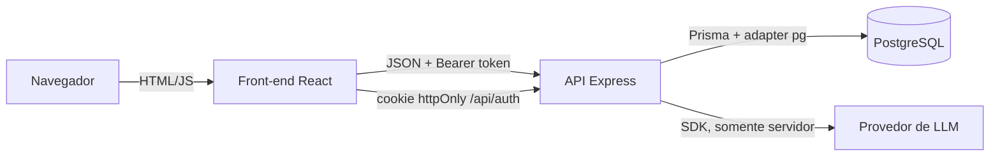
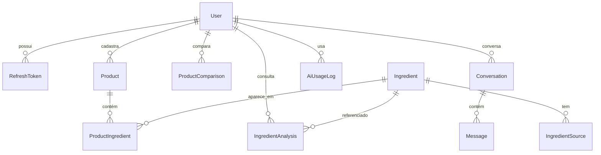
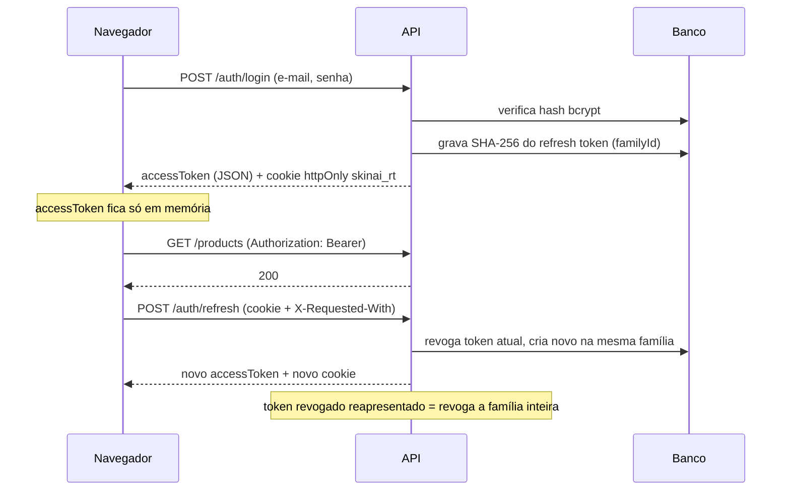

# Arquitetura do SkinAI

## Visão geral

O SkinAI é um monorepo com dois workspaces npm:

- `backend/`: API REST em Express 5 + TypeScript, com Prisma 7 e PostgreSQL.
- `frontend/`: SPA em React 19 + Vite, que consome exclusivamente a API.



## Back-end

### Camadas

Cada módulo de domínio segue o mesmo fluxo:

```
routes.ts   → valida entrada (Zod), lê o usuário autenticado e chama o serviço
service.ts  → regras de negócio e autorização por userId
Prisma      → acesso a dados (todas as consultas privadas filtram por userId)
```

Funções puras ficam separadas para testes sem banco:

- `modules/comparisons/compare-products.ts`: comparação determinística.
- `modules/ingredients/ingredient-names.ts`: normalização e deduplicação de nomes.

`app.ts` recebe o `AiService` por injeção de dependência (`createApp({ ai })`). Isso permite testar a API inteira com um provedor de IA de teste, sem simular respostas em produção.

### Modelo de dados



Decisões:

- **Ingredient é global** e identificado por `normalizedName` único. `searchTerms` guarda sinônimos normalizados (índice GIN) para que "Glicerina" e "Glycerin" apontem para o mesmo registro. `isCurated` separa conteúdo revisado de nomes vindos de rótulos.
- **ProductIngredient** tem chave composta (`productId`, `ingredientId`) e `position`, preservando a ordem do rótulo.
- **ProductComparison.result** guarda um retrato do resultado (JSON). Se um produto for editado ou excluído depois, o histórico continua coerente.
- **AiUsageLog** fica separado do histórico para que apagar conversas não zere a cota diária.
- Dados privados usam `onDelete: Cascade` a partir de `User`; `ProductIngredient → Ingredient` usa `Restrict` para proteger o catálogo.

### Autenticação



O front-end compartilha uma única requisição de refresh entre chamadas simultâneas, evitando que a rotação seja confundida com reuso.

### Serviço de IA

```
LlmProvider (interface)
 └── AnthropicProvider      ← SDK oficial; erros convertidos em LlmProviderError
AiService                   ← independente de fornecedor
 ├── verifica se há provedor configurado (503 AI_NOT_CONFIGURED com instruções)
 ├── verifica cota diária por usuário (429)
 ├── aplica tempo limite com AbortController (504)
 ├── valida a resposta (vazia ou longa demais → 502)
 ├── registra uso (sem conteúdo) e erros (sem segredos)
 └── monta o prompt de sistema com as regras de responsabilidade
```

Para adicionar outro provedor: implementar `LlmProvider`, incluir o valor em `AI_PROVIDER` (`config/env.ts`) e registrar em `provider-factory.ts`.

Dados do usuário (produtos, nomes de ingredientes) vão para o modelo dentro de `<dados>...</dados>`, com instrução explícita para tratá-los como informação e não como comando.

### Retenção

`modules/history/retention.ts` executa na inicialização e a cada 24 horas, removendo históricos expirados, registros de uso da IA com mais de 30 dias e refresh tokens vencidos ou revogados.

## Front-end

```
src/
├── auth/        AuthProvider (sessão), guardas de rota
├── lib/         api.ts (fetch + refresh automático), queries.ts (TanStack Query), formatação
├── components/  layout, UI reutilizável (botões, campos acessíveis, diálogo, toasts, chips)
└── features/    páginas por domínio, com rotas carregadas sob demanda
```

- **Estado do servidor** em TanStack Query, com chaves centralizadas e invalidação após mutações.
- **Formulários** com React Hook Form + Zod, espelhando as regras do back-end; erros de validação do servidor são exibidos no campo correspondente.
- **Acessibilidade:** rótulos associados, `aria-invalid` e `aria-describedby`, link para pular ao conteúdo, foco visível, diálogo nativo `<dialog>`, abas com navegação por setas, regiões `aria-live` e respeito a `prefers-reduced-motion`.

### Identidade visual

Conceito "marca-texto no rótulo": o amarelo (`#F4C542`) marca o que importa (ação principal, item ativo, ingredientes em comum) e nunca é usado como cor de texto sobre branco. Tipografia: Bricolage Grotesque (títulos e logotipo) e Hanken Grotesk (interface), ambas servidas localmente via Fontsource.
