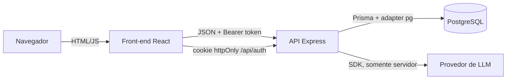
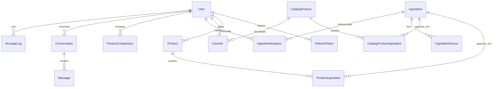
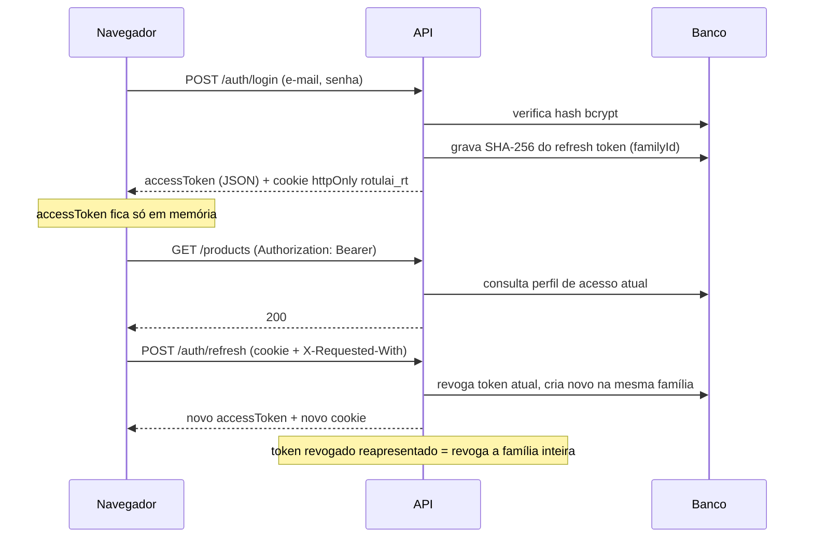

# Arquitetura do Rotulai

## Visão geral

O Rotulai é um monorepo com dois workspaces npm:

- `backend/`: API REST em Express 5 + TypeScript, com Prisma 7 e PostgreSQL.
- `frontend/`: SPA em React 19 + Vite, que consome exclusivamente a API.



## Back-end

### Camadas

Cada módulo de domínio segue o mesmo fluxo:

```
routes.ts   → valida entrada (Zod), lê o usuário autenticado e chama o serviço
service.ts  → regras de negócio e autorização por userId
Prisma      → acesso a dados (todas as consultas privadas filtram por userId)
```

Funções puras ficam separadas para testes sem banco:

- `modules/comparisons/compare-products.ts`: comparação determinística.
- `modules/ingredients/ingredient-names.ts`: normalização e deduplicação de nomes.

`app.ts` recebe o `AiService` por injeção de dependência (`createApp({ ai })`). Isso permite testar a API inteira com um provedor de IA de teste, sem simular respostas em produção.

### Modelo de dados



Decisões:

- **Ingredient é global** e identificado por `normalizedName` único. `searchTerms` guarda sinônimos normalizados (índice GIN) para que "Glicerina" e "Glycerin" apontem para o mesmo registro. `isCurated` separa conteúdo revisado de nomes vindos de rótulos.
- **ProductIngredient** tem chave composta (`productId`, `ingredientId`) e `position`, preservando a ordem do rótulo.
- `User.role` persiste um dos perfis `FREE`, `PREMIUM` ou `ADMIN`; o cadastro público sempre cria `FREE`. O middleware consulta o perfil atual no banco em cada requisição autenticada, para que mudanças de permissão não dependam da expiração do JWT.
- **CatalogProduct** e `CatalogProductIngredient` representam o catálogo global curado; `Favorite` relaciona usuários a itens desse catálogo. `Product`/`ProductIngredient` continuam preservados como registros pessoais legados durante a migração, sem serem publicados automaticamente.
- O seed de ingredientes e `db:seed-public` são não destrutivos: não apagam contas, não recriam usuário de demonstração e não sobrescrevem conteúdo existente. O primeiro Admin é criado pelo comando `npm run admin:bootstrap -w backend`, com credenciais fornecidas pelo ambiente.
- O catálogo público pesquisa por nome/marca e categoria; a referência de ingredientes pública mostra apenas `Ingredient.isCurated = true`. Detalhes públicos não retornam produtos do usuário.
- A busca pública usa `pg_trgm` + `unaccent`, índices GIN de expressão no nome/marca e uma tabela `CatalogSearchSynonym` para expansão editável de frases. O endpoint devolve sugestões separadas quando não encontra correspondência exata. Ver [docs/BUSCA-CATALOGO.md](./BUSCA-CATALOGO.md).
- **ProductComparison.result** guarda um retrato do resultado (JSON). Se um produto for editado ou excluído depois, o histórico continua coerente.
- **AiUsageLog** fica separado do histórico para que apagar conversas não zere a cota diária.
- Dados privados usam `onDelete: Cascade` a partir de `User`; `ProductIngredient → Ingredient` usa `Restrict` para proteger o catálogo.
- `CatalogProductIngredient → Ingredient` também usa `Restrict`; apagar um ingrediente em uso público não é permitido sem atualizar primeiro os vínculos.

### Autenticação



O front-end compartilha uma única requisição de refresh entre chamadas simultâneas, evitando que a rotação seja confundida com reuso.

  O JWT identifica a conta, mas não concede um perfil: `requireAuth` lê `User.role` no PostgreSQL e `requireRole` aplica a autorização no backend. O comando de bootstrap promove uma conta existente somente quando a senha fornecida confere; caso contrário, não altera a conta.

### Serviço de IA

```
LlmProvider (interface)
 └── AnthropicProvider      ← SDK oficial; erros convertidos em LlmProviderError
AiService                   ← independente de fornecedor
 ├── verifica se há provedor configurado (503 AI_NOT_CONFIGURED com instruções)
 ├── verifica cota diária por usuário (429)
 ├── aplica tempo limite com AbortController (504)
 ├── valida a resposta (vazia ou longa demais → 502)
 ├── registra uso (sem conteúdo) e erros (sem segredos)
 └── monta o prompt de sistema com as regras de responsabilidade
```

Para adicionar outro provedor: implementar `LlmProvider`, incluir o valor em `AI_PROVIDER` (`config/env.ts`) e registrar em `provider-factory.ts`.

Dados do usuário (produtos, nomes de ingredientes) vão para o modelo dentro de `<dados>...</dados>`, com instrução explícita para tratá-los como informação e não como comando.

### Retenção

`modules/history/retention.ts` executa na inicialização e a cada 24 horas, removendo históricos expirados, registros de uso da IA com mais de 30 dias e refresh tokens vencidos ou revogados.

## Front-end

```
src/
├── auth/        AuthProvider (sessão), guardas de rota
├── lib/         api.ts (fetch + refresh automático), queries.ts (TanStack Query), formatação
├── components/  layout, UI reutilizável (botões, campos acessíveis, diálogo, toasts, chips)
└── features/    páginas por domínio, com rotas carregadas sob demanda (inclui `public-catalog/`)
```

- **Estado do servidor** em TanStack Query, com chaves centralizadas e invalidação após mutações.
- **Formulários** com React Hook Form + Zod, espelhando as regras do back-end; erros de validação do servidor são exibidos no campo correspondente.
- **Acessibilidade:** rótulos associados, `aria-invalid` e `aria-describedby`, link para pular ao conteúdo, foco visível, diálogo nativo `<dialog>`, abas com navegação por setas, regiões `aria-live` e respeito a `prefers-reduced-motion`.

### Identidade visual

Conceito "marca-texto no rótulo" com paleta verde-sálvia: verde profundo (`#1F4D3F`) para ações principais e marca, verde médio (`#3FA37A`) para detalhes decorativos e menta (`#DDF1E6` / `#BFE6D2`) como marcador suave de itens ativos e ingredientes em comum. O verde médio não é usado como cor de texto pequeno sobre branco. Tipografia: Bricolage Grotesque (títulos e logotipo) e Hanken Grotesk (interface), ambas servidas localmente via Fontsource.
